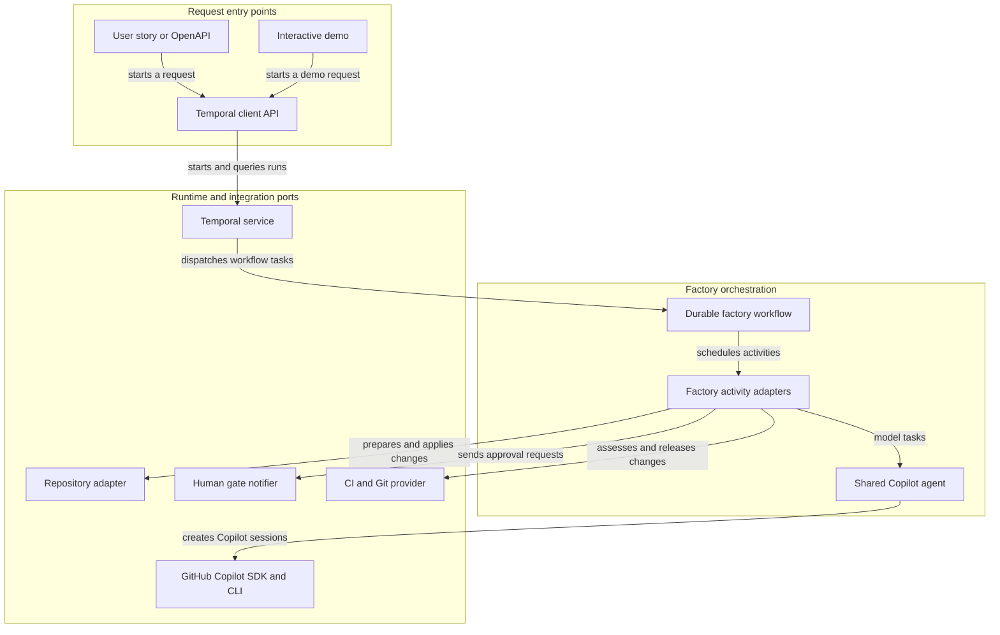
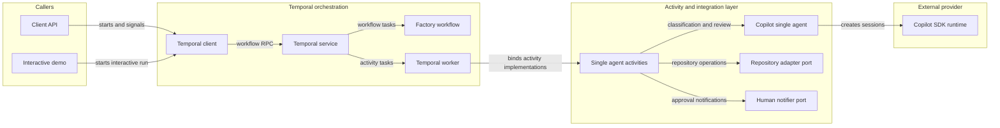

# Architecture Diagram

Hybrid AI Factory coordinates specification-driven web and API automation through Temporal workflows and pluggable activity adapters. The Copilot SDK agent is implemented; production repository, human notification, CI, pull request, merge, and persistent memory integrations remain adapter ports.

## Application Architecture

<!-- mermaid-checked: no \n, no em-dash/en-dash, no {} in labels, subgraphs are id["label"], arrows are -->|"label"|, all subgraphs closed by end, ids unique -->

### Technology Stack Summary

| Layer | Technology | Version | Purpose |
|---|---|---|---|
| Language | TypeScript | ^5.9.3 | Strictly typed application and workflow code |
| Runtime | Node.js | 20+ | Runs the client, worker, demo, and tests |
| Orchestration | Temporal Client, Worker, Workflow | ^1.25.0 | Durable workflows, activity execution, signals, and queries |
| Agent integration | GitHub Copilot SDK | ^1.0.29 | Shared model session for drafting, generation, correction, and review |
| Testing | Node.js test runner and Temporal testing | Built in, ^1.25.0 | Unit and workflow integration tests |

### Data Storage & External Services

There is no application database or cache in this implementation. The Temporal service stores durable workflow history and state. Copilot CLI authentication is used by the SDK. Repository access, human notifications, CI, pull requests, merge operations, and Engram memory are represented by integration interfaces; the demo repository and console notifier are in-memory/local implementations.

### Key Architectural Decisions

- The Temporal workflow owns deterministic orchestration; network and model operations run through activities.
- One shared Copilot agent instance handles distinct task personas, so reviewer calls are concurrent but are not independent models.
- Artifact review happens before repository preparation. Workflow history carries bounded summaries rather than repository contents or credentials.

## Component Relationships

<!-- mermaid-checked: no \n, no em-dash/en-dash, no {} in labels, subgraphs are id["label"], arrows are -->|"label"|, all subgraphs closed by end, ids unique -->

### Component Inventory

| Component | Layer | Type | Responsibility |
|---|---|---|---|
| Client API | Callers | TypeScript module | Starts workflow runs and submits human decisions or status queries |
| Interactive demo | Callers | CLI application | Runs a local demo with a console approval gate |
| Temporal client | Orchestration | SDK client | Sends workflow start, signal, and query requests |
| Temporal service | Orchestration | Workflow runtime | Persists workflow history and dispatches workflow and activity tasks |
| Factory workflow | Orchestration | Durable workflow | Enforces artifact approval, build, review, correction, release, and PR gates |
| Temporal worker | Orchestration | Worker process | Executes workflow code and registered activity implementations |
| Single agent activities | Activity layer | Activity adapter | Coordinates agent tasks and delegates repository, notifier, and release operations |
| Copilot single agent | Activity layer | SDK adapter | Creates and disposes Copilot sessions for model requests |
| Repository adapter port | Integration layer | Interface | Prepares workspaces, applies changes, reads diffs, and requests PR or merge operations |
| Human notifier port | Integration layer | Interface | Delivers durable approval gate requests to a human interface |
| Copilot SDK runtime | Provider | External SDK/runtime | Authenticates and communicates with the configured Copilot model |
