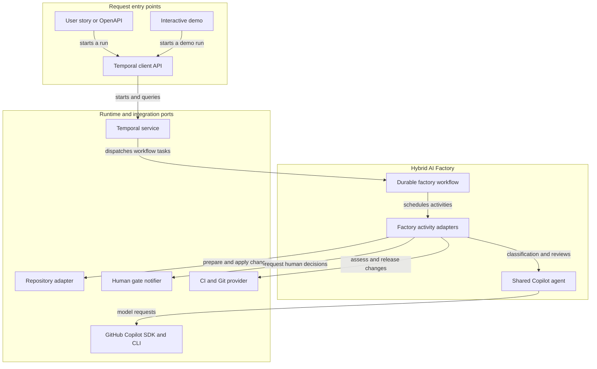

# Hybrid AI Factory

Temporal + TypeScript orchestration for generating API (Karate DSL) and Web (Playwright TypeScript) automation from a user story or OpenAPI contract.

## Workflow guarantees

- Neither repository indexing (`prepareRepository`) nor code generation can run until the generated artifact has been explicitly approved.
- After approval, `prepareRepository` indexes the target; only a short structure summary enters workflow history. The builder then generates Karate for OpenAPI or Playwright for a user story.
- ODD artifacts must be non-empty Markdown; SDD artifacts must be non-empty YAML.
- Human gates are Temporal signals and remain pending durably until a decision arrives. There is intentionally no implicit approval or timeout.
- Security (Sol), UX (Sol), UI (Astra), and code (Sonnet) reviews run concurrently on each review round.
- Failed reviews or Approver findings return to the Builder. After three correction attempts the run stops in `NEEDS_HUMAN_INTERVENTION`.
- Change size is supplied by a separate `assessChangeSize` activity; it must apply deterministic policy, not an LLM guess. SMALL is merged automatically; LARGE creates a PR and waits for a human decision. Approval of a large PR does not merge it.
- Brain/Orchestrator, Builder, all four reviewer personas, and Approver share one `SingleAgent` instance. This is a practical single-model simulation, not four independent agents.
- The default size policy is deterministic: SMALL means at most 5 changed files and 200 changed lines. These are configurable thresholds, not a model decision.
- Temporal activities are integration ports. The GitHub Copilot SDK adapter is implemented, while Engram's persistent memory, production repository, notification, CI, PR, and merge adapters still need to be supplied.

## Architecture

The diagram shows the main runtime flow. The [detailed architecture and component relationships](.github/modernize/assessment/engines/facts/architecture-diagram.md) include the technology inventory and integration boundaries.

<!-- mermaid-checked: no \n, no em-dash/en-dash, no {} in labels, subgraphs are id["label"], arrows are -->|"label"|, all subgraphs closed by end, ids unique -->


## Implementing the activity adapters

Provide an object implementing `FactoryActivities` and pass it to `runFactoryWorker`. `createCopilotFactoryActivities` creates one shared GitHub Copilot agent for every model task. It uses Copilot CLI authentication; no provider API key is configured by this application.

- `notifyHumanGate`: deliver an authenticated approval request containing the gate ID and artifact/PR details.
- `classifyAndDraft`, `buildAutomation`, `correctAutomation`, `reviewCode`, and `approveRelease`: all call the same agent instance with distinct task instructions/personas.
- `prepareRepository`: clone/read and index only after artifact approval, using an isolated workspace and bounded context.
- `reviewCode`: run the four reviewer personas concurrently; they share the same agent/model in this first iteration.
- `approveRelease`: release review after all four reviewer calls pass. Keep hard CI/policy checks deterministic and outside the model.
- `assessChangeSize`: calculate SMALL/LARGE from a versioned policy and return its rationale.
- `mergeToMain` / `createPullRequest`: Git-provider integration, with protected-branch and CI safeguards.

Do not pass credentials or repository contents through workflow history. Keep secrets in worker-side integrations and keep activity inputs/results to the minimum needed. Repository adapters must allowlist Git hosts, reject local/private-network destinations and non-Git protocols, and use short-lived, least-privilege credentials. Use a scoped, temporary checkout; do not make changes during classification or artifact approval.

## Where specifications and code are saved

- Before approval, the artifact is held in the Temporal workflow state and displayed to the human gate. The target repository has not been cloned, read, or changed.
- After approval, the repository adapter indexes the repo. In the same isolated branch/worktree as the generated automation, the approved specification is planned for `.factory/specs/<requestId>.md` for ODD or `.factory/specs/<requestId>.yaml` for SDD.
- The generated Karate/Playwright files are committed to that same working branch. Small changes follow the configured merge policy; large changes produce a PR. The path is part of the reviewed artifact, so the human can see where it will be stored before approving.
- In the current demo/tests, the "repository" is in-memory; no actual repository is cloned or modified. The in-memory adapter proves the spec and automation are passed together as changed files. A production `RepositoryAdapter` is still needed to persist them into the real repo.

## Local development

Requires Node.js 20+. `npm test` starts a temporary local Temporal test server; a deployed worker requires a reachable Temporal server.

```powershell
npm install
npm run typecheck
npm run build
npm test
```

`npm test` starts a local Temporal test server and executes both ODD/SMALL and SDD/LARGE workflows against one deterministic demo agent and an in-memory repository. It does not clone, change, or merge a real repository.

To try the same workflow with GitHub Copilot, install and sign in to Copilot CLI first. The SDK includes its compatible runtime, but this workspace still needs a Copilot CLI sign-in:

```powershell
copilot
# Complete the Copilot sign-in if prompted, then exit the CLI.
$env:COPILOT_MODEL = "<optional model ID available to your Copilot account>"
npm run demo
```

The demo prompts for the human decision at each gate and requires Copilot authentication. It uses a reserved `.invalid` repository URL and an in-memory repository, so it never accesses a real Git repository. The test server may download its local Temporal CLI on first run. Requests and diff context are sent to the Copilot model configured for the account; review your organization's Copilot data policy before sending sensitive content.

## Still needed for a production factory

- A real `RepositoryAdapter` for the chosen Git provider, including repository allowlisting, read-only indexing, isolated worktrees, safe patch application, and branch cleanup.
- An authenticated `HumanGateNotifier` and API/UI for creating runs, viewing `readFactoryStatus`, and submitting decisions with the current `gateId`.
- Real CI/test-run integration for generated Karate and Playwright files, with captured results supplied to the review/approval gates.
- A Git-provider adapter for PR creation and an explicitly protected small-change merge policy; the demo merge is only an in-memory marker.
- Operational configuration: approved Copilot model/account policy, Temporal deployment/namespace, access control, and retention policy for workflow history.
- Engram Core's persistent memory/knowledge retrieval and a policy defining which change sizes may auto-merge.
